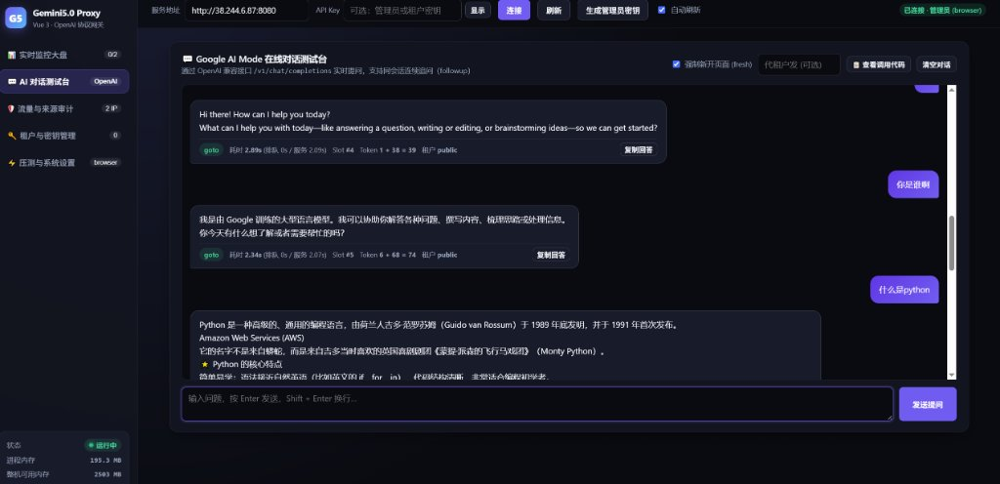
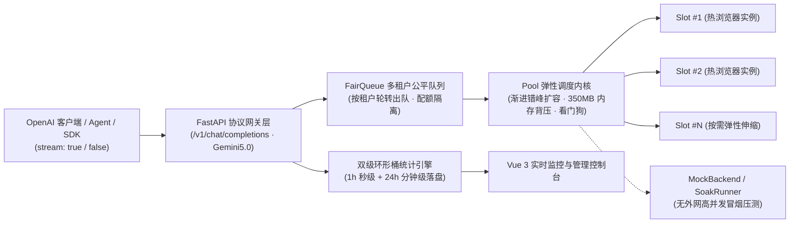

<div align="center">


<br/>

<a href="https://ys666.site" target="_blank">
  
</a>

<br/>

**[💡 特殊渠道原理](#-一句话讲清楚它是怎么实现的) · [📸 线上实测效果](#-线上实测效果展示) · [🚀 30秒快速接入](#-30-秒快速接入openai-兼容协议) · [🧠 核心架构设计](#-核心架构与工程亮点) · [🛠️ 一键部署指南](#️-安装与部署指南)**

</div>

---

## 💡 一句话讲清楚：它是怎么实现的？

> [!TIP]
> **普通人也能秒懂的原理**：  
> 现在想用 Google 的 AI 模型，常规路子要么**绑不了海外信用卡申请不到 API Key**，要么**一登录 Google 账号就被封号或提示地区不支持**。  
> 本项目走了一条完全不同的**特殊渠道**——直接通过后台无头浏览器池，调用**谷歌搜索引擎内置的 AI 问答接口（Google Search AI Mode，`udm=50` 特殊通道）**，并在外层包装成大家最熟悉的 **OpenAI 标准接口（对外模型名：`Gemini5.0`）**。

### 🆚 三种方案直观对比

| 对比维度 | 传统官方 API 渠道 | 普通网页版登录反代 | ⚡ 本项目（谷歌搜索 AI 特殊渠道） |
| :--- | :---: | :---: | :---: |
| **是否需要 Google 账号** | 需要（且需绑海外卡） | 需要（高频封号/掉登录） | **🟢 完全免账号（零封号风险）** |
| **实时联网搜索能力** | 需额外付费开启 Grounding | 依赖页面状态 | **🟢 原生自带谷歌实时全网搜索** |
| **客户端调用协议** | Google 私有格式 | 各家自定义格式 | **🟢 标准 OpenAI `/v1/chat/completions`** |
| **单次响应速度 (热实例)** | ~1.5s | 8s ~ 20s | **🟢 实测 2.07s ~ 2.89s (极速直连)** |
| **多租户与可视化大盘** | 无 | 简陋 | **🟢 内置 Vue 3 实时监控与配额大盘** |

---

## 📸 线上实测效果展示

<div align="center">
  
</div>

<br/>

| 实测指标（2 核 4GB Linux 服务器） | 实测数据（见上方截图） | 说明 |
| :--- | :--- | :--- |
| **🚀 首次提问耗时 (`Hi there!`)** | **总耗时 `2.89s`**（排队 `0s` / 服务 `2.09s`） | 热实例无状态 `goto` 一步直达 |
| **⚡ 连续提问耗时 (`你是谁啊`)** | **总耗时 `2.34s`**（排队 `0s` / 服务 `2.07s`） | 检测 `response is ready` 信号即刻返回 |
| **🪶 服务主进程内存 (`RSS`)** | **`195.3 MB`**（整机剩余可用 `2503 MB`） | 内置 `350MB` 动态物理内存背压保护 |
| **🔌 协议兼容度** | **OpenAI 100% 兼容**（模型名 `Gemini5.0`） | 同时支持 `stream: true` 流式 SSE 与非流式 JSON |

---

## 🚀 30 秒快速接入（OpenAI 兼容协议）

任何支持自定义 OpenAI 接口的客户端（**Cursor、Cline、NextChat、LobeChat、Cherry Studio、Dify、OneAPI、LangChain** 等）填上就能直接用：

| 配置项 | 填写内容 |
| :--- | :--- |
| **API Base URL** | `http://<你的服务器IP>:8080/v1` |
| **API Key** | 控制台生成的 `sk-...`（未开启鉴权时随便填任意字符即可） |
| **Model 模型名** | **`Gemini5.0`**（同时兼容 `google-ai-mode`） |

### 1️⃣ cURL 直接调用

```bash
curl -X POST http://127.0.0.1:8080/v1/chat/completions \
  -H "Content-Type: application/json" \
  -H "Authorization: Bearer sk-your-key" \
  -d '{
    "model": "Gemini5.0",
    "stream": false,
    "messages": [
      {"role": "system", "content": "你是一个专业、简明的技术助手"},
      {"role": "user", "content": "什么是 Python？"}
    ]
  }'
```

### 2️⃣ Python OpenAI SDK 调用（支持 `stream=True` / `False`）

```python
from openai import OpenAI

client = OpenAI(
    base_url="http://127.0.0.1:8080/v1",
    api_key="sk-your-key",  # 未开启鉴权时可任意填写
)

resp = client.chat.completions.create(
    model="Gemini5.0",
    messages=[
        {"role": "system", "content": "你是一个专业助手"},
        {"role": "user", "content": "用一句话介绍 FastAPI"},
    ],
    stream=True,
)

for chunk in resp:
    print(chunk.choices[0].delta.content or "", end="", flush=True)
```

---

## 🧠 核心架构与工程亮点

传统基于无头浏览器的脚本普遍存在**“单线程阻塞、内存爆炸、多用户串上下文、页面崩溃后死锁”**四大顽疾。本项目设计了完整的四层企业级调度内核：



| 核心模块 | 解决的痛点与实现机制 |
| :--- | :--- |
| **🎯 无状态 `goto` + 长文本自动切 `POST`** | 默认每次请求走无状态直连 `goto` 并在跳转前清空旧 DOM，彻底杜绝多用户串上下文；当 Agent 传入的 `system` 背景超过 URL 长度阈值（1800 字节）时，自动切至页面 `textarea`（走 POST 无长度限制，最高支持 60,000 字符）。 |
| **⚖️ `FairQueue` 多租户轮转公平队列** | 摒弃容易导致饥饿的全局 FIFO 队列，每个租户拥有独立子队列，Worker 出队时在活跃租户间 **Round-Robin 轮转**；支持按租户限制并发与排队上限，超限秒回 `429`。 |
| **🛡️ 动态内存背压 + 错峰扩容 + 看门狗** | 扩容前实时检查 `/proc/meminfo` 的 `MemAvailable`（低于 `350MB` 自动暂停扩容防 OOM）；超出保活数后按 `2.5s` 冷却步进扩容避免单 IP 突发风控；内置 `_is_alive()` 崩溃自愈与 `Watchdog` 超时强制摘除，永不死锁。 |
| **📡 SSE 首包秒回 + 双环形桶监控台** | `stream: true` 请求入队 **< 10ms** 即返回首个 `chat.completion.chunk` 并每 5s 发送 `: ping` 保活；内存维护 1h 秒级 + 24h 分钟级环形桶，在 **Vue 3 控制台**实时呈现 TPS/Token 曲线、P50/P95/P99 延迟、IP 审计与无外网冒烟压测。 |

---

## 🛠️ 安装与部署指南

### 1. 一键安装依赖（Ubuntu 22.04 / 24.04）

```bash
# 1. 安装 Google Chrome 与 libatomic1 等系统依赖
bash deploy/install_chrome.sh

# 2. 创建 Python 虚拟环境并安装依赖
python3 -m venv venv
./venv/bin/pip install --upgrade pip
./venv/bin/pip install -r requirements.txt tiktoken
```

### 2. 配置并启动服务

```bash
cp proxy_svc/.env.example .env
# 按需编辑 .env，然后启动服务
./venv/bin/python -m uvicorn proxy_svc.app:app --host 0.0.0.0 --port 8080 --workers 1
```

> [!IMPORTANT]
> **生产环境后台常驻（systemd）**：
> ```bash
> cp deploy/proxy.env /opt/gemini-pro/proxy.env
> cp deploy/gemini-pro.service /etc/systemd/system/gemini-pro.service
> systemctl daemon-reload && systemctl enable --now gemini-pro
> ```
> 启动后浏览器打开 **`http://<服务器IP>:8080/`** 即可进入 **Vue 3 控制台**。

<details>
<summary><b>📋 点击展开：完整 HTTP API 接口列表与目录结构</b></summary>

<br/>

#### HTTP API 接口一览

| 方法 | 路径 | 说明 |
| :--- | :--- | :--- |
| `GET` | `/` , `/panel/` | Vue 3 可视化监控与管理控制台 |
| `GET` | `/v1/models` | OpenAI 模型列表（返回 `Gemini5.0`、`google-ai-mode`） |
| `POST` | `/v1/chat/completions` | OpenAI Chat Completions 接口（支持 `stream: true/false`、`tools`） |
| `POST` | `/ask` | 直接提问接口（支持 `wait: false` 异步入队返回 `task_id`） |
| `POST` | `/ask/batch` | 批量并发提问接口（单次最多 64 条） |
| `GET / DELETE` | `/tasks/{task_id}` | 查询异步任务状态与结果 / 取消排队或执行中的任务 |
| `GET` | `/health` | 实例池状态、队列深度、进程 RSS 内存与整机可用内存 |
| `GET` | `/admin/metrics` | TPS/Token 趋势序列、分位延迟、来源 IP 审计、最近请求明细 |
| `GET / POST` | `/admin/settings` | 读取 / 热更新运行时参数（支持在线热切换 `browser` / `mock` 后端） |
| `POST / PATCH / DELETE` | `/admin/keys` | 创建、启停、修改配额、轮换或删除租户 API Key |
| `POST` | `/admin/soak/start` , `/stop` | 启动 / 停止无外网 Mock 冒烟压测器 |

#### 目录结构

```text
├── proxy_svc/
│   ├── app.py              # FastAPI 路由入口、OpenAI 协议适配与 SSE 流式保活
│   ├── config.py           # 环境变量解析、机器容量探测与 settings.json 热持久化
│   ├── metrics.py          # 秒级/分钟级双环形桶统计与持久化
│   ├── worker.py           # Playwright 浏览器驱动、无状态 goto / 长文本 POST 与自愈
│   ├── solver.py           # 验证码异步任务提交与轮询
│   ├── fingerprint.py      # 浏览器上下文视口、Locale 与环境初始化
│   ├── backends/           # 可插拔后端抽象 (browser 真实浏览器 / mock 模拟压测)
│   ├── core/               # 调度内核 (FairQueue / Pool / SoakRunner / Tokens / Sysinfo)
│   └── static/             # Vue 3 打包产物（开箱即用）
├── web/                    # Vue 3 + Vite 控制台前端源码
├── deploy/                 # systemd 服务配置、Chrome 安装脚本与部署工具
└── docs/                   # README 矢量横幅与实测截图资源
```

</details>

---

## 🔗 友情链接 (Friendly Links)

- **[🐧 LINUX DO 社区 (https://linux.do)](https://linux.do)** —— 真诚、友善、团结、专业，共建你我引以为荣之技术社区。
- **[💎 跃数AI (https://ys666.site)](https://ys666.site)** —— 稳定、高速的一站式企业级大模型 API 与算力服务平台。

---

<div align="center">

### 🤝 赞助与鸣谢

感谢 **[💎 跃数AI (https://ys666.site)](https://ys666.site)** 对本开源项目提供算力与研发赞助支持，感谢 **[🐧 LINUX DO](https://linux.do)** 社区各位佬友的交流与反馈！  
如果本项目对你有帮助，欢迎点一个 ⭐ **Star** 支持！

</div>
