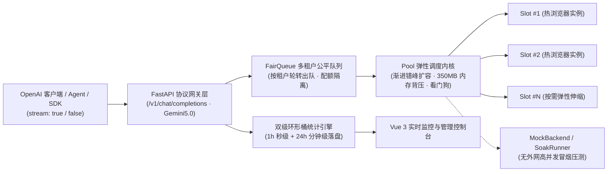

# ⚡ Gemini5.0 Proxy

> **“天道崩塌，谷狗封杀，我自一剑破之。”**  
> **一句话读懂本项目**：由于常规渠道封号、锁区严格，本项目另辟蹊径，**利用谷歌搜索引擎内置的 AI 问答特殊渠道（Google Search AI Mode）**——无需登录 Google 账号、无需申请官方 API Key、无需绑卡付费，直接将其转化为高并发、多租户、自带联网搜索能力的 **标准 OpenAI 兼容接口（模型名：`Gemini5.0`）**，并配备 **Vue 3 实时监控控制台**。

`Python 3.10+` · `FastAPI Async` · `Vue 3 + Vite` · `OpenAI Protocol Compatible` · `免账号 / 自带联网搜索`

---

## 📢 赞助商广告位 (Sponsors)

| 🏆 首席赞助商 | 官方直达地址 | 简介 |
| :---: | :---: | :--- |
| **💎 跃数AI** | **[https://ys666.site](https://ys666.site)** | **本项目由 [跃数AI (ys666.site)](https://ys666.site) 独家赞助支持** —— 稳定、高速、低延迟的一站式 AI 大模型 API 与算力服务平台，开箱即用，欢迎体验！ |

---

## 💡 它是怎么做到的？（大白话版）

现在很多开发者想用 Gemini，但要么**申请不到 API Key / 绑不了海外信用卡**，要么**Google 账号一登录网页版就被封号或提示地区不支持**。

本项目走了一条完全不同的**特殊渠道**：
1. **借道谷歌搜索引擎内置 AI 接口**：直接通过无头浏览器池访问谷歌搜索的 AI 对话入口（`udm=50` 搜索 AI 渠道），**全程不需要登录任何 Google 账号（零封号风险）**，而且回答天生自带**谷歌实时联网搜索能力**。
2. **包装成标准 OpenAI 接口**：后台帮你把浏览器池、排队、指纹保活全干完了，对外只暴露一个标准的 OpenAI `/v1/chat/completions` 接口（模型名填 `Gemini5.0`）。你平时怎么调 ChatGPT / DeepSeek，现在就怎么调它。

---

## 📸 实测效果展示


在 **2 核 4GB** 轻量 Linux 服务器上的线上实测表现（见上图）：
- **端到端响应耗时**：热实例直连 `goto` 模式下，单次提问总耗时 **2.34s ～ 2.89s**（其中排队 `0s`，服务执行仅 **2.07s ～ 2.09s**）。
- **低内存占用**：主进程常驻内存仅 **~195 MB**，整机剩余可用物理内存 **2500+ MB**。
- **开箱即用**：对外统一暴露标准 OpenAI 模型名 `Gemini5.0`，无需维护复杂会话状态，各类 Agent、工具、SDK 可直接携带 `system` 背景与上下文单次直连调用。

---

## 🧠 核心实现原理与架构设计

传统基于无头浏览器的网页反代脚本普遍存在**“单线程阻塞、内存爆炸、容易串上下文、卡死不释放槽位”**四大痛点。本项目通过**四层解耦架构**解决了上述工程瓶颈：



### 1. 无状态极速直连（`goto` 优化 + 长文本自动切 `POST`）
- **默认无状态隔离（`fresh=True`）**：针对外部 Agent 和工具自带完整 `messages` 上下文的调用特点，每次请求默认走全新 `goto` 导航并在跳转前清空旧 DOM，彻底杜绝多用户或多轮请求之间的上下文污染。
- **短文本直连 / 超长文本自动切 `POST`**：常规提问直接通过 URL 参数一步直达结果页；当工具传入的 `system` 背景 + 上下文编码后超过 `1800` 字节时，自动切换为页面 `textarea` 提交（走 POST 通道，最高支持 `60,000` 字符，避免 HTTP 414 URI Too Long）。
- **实时完成信号检测**：直接捕获页面 `AI Mode response is ready` 完成信号，一旦文本停稳即刻返回，比传统固定静默等待缩短 **1.2s+**。

### 2. 多租户轮转公平队列（`FairQueue`）与三层配额隔离
- **拒绝饥饿**：不同于传统全局 FIFO 队列（单个用户突发 100 个请求会堵死后面所有人），`FairQueue` 为每个租户维护独立子队列，Worker 出队时在活跃租户间**轮转（Round-Robin）**取单。
- **配额保护**：支持按租户配置 `max_concurrent`（最大并发）与 `queue_limit`（排队上限），超限请求立即快速拒绝（`HTTP 429`），绝不拖垮整个池子。

### 3. 自适应内存背压、渐进错峰扩容与槽位看门狗（`Watchdog`）
- **多用户复用热浏览器**：默认开启热实例跨请求复用（`TENANT_ROTATE_IDENTITY=false`），切换租户时只做无状态页面导航而不重启 Chrome，省去 2.5s 进程冷启动开销。
- **350MB 动态物理内存背压**：每次扩容前实时读取系统 `/proc/meminfo` 的 `MemAvailable`，仅在整机可用物理内存 ≥ `350MB` 时继续扩容，从根源上防止 Linux OOM Killer 杀进程。
- **2.5s 渐进式错峰扩容**：超出保活实例数后按 `2.5s` 冷却步进扩容，避免同一毫秒内单 IP 并发冷启动多个浏览器触发突发风控与 CPU 尖峰。
- **死锁自愈与看门狗**：内置 `_is_alive()` 句柄存活检测与 `Pool._reap()` 槽位超时看门狗；浏览器异常断开时自动销毁重建并重试，超时任务自动强制摘除并幂等归还配额。

### 4. 双级环形桶遥测（`Metrics`）与无外网冒烟压测（`SoakRunner`）
- **常数内存环形桶**：内存中维护 `3600` 个秒级桶（1 小时）与 `1440` 个分钟级桶（24 小时，定时落盘到 `data/metrics.json`），实时计算 `10s / 60s / 1h峰值 TPS`、`Token/min`（支持 `tiktoken/cl100k_base` 精确分词）、`P50 / P95 / P99` 延迟、来源 IP 审计与租户累计用量。
- **`stream: true` 首包秒回与心跳保活**：流式请求入队后 **< 10ms** 即返回首个 `chat.completion.chunk`，等待期间每 5 秒发送 `: ping` SSE 注释帧保活，防止反向代理或客户端 `ReadTimeout`。

---

## 🚀 快速调用指南（OpenAI 兼容协议）

任何支持自定义 OpenAI Base URL 的客户端（Cursor、Cline、NextChat、LobeChat、Dify、OneAPI、LangChain 等）均可直接接入：

| 配置项 | 值 |
| :--- | :--- |
| **Base URL** | `http://<服务器IP>:8080/v1` |
| **API Key** | 控制台生成的 `sk-...`（未开启鉴权时可填任意非空字符串） |
| **Model** | `Gemini5.0`（同时兼容 `google-ai-mode`） |

### 1. cURL 调用

```bash
curl -X POST http://127.0.0.1:8080/v1/chat/completions \
  -H "Content-Type: application/json" \
  -H "Authorization: Bearer sk-your-key" \
  -d '{
    "model": "Gemini5.0",
    "stream": false,
    "messages": [
      {"role": "system", "content": "你是一个简明扼要的技术助手"},
      {"role": "user", "content": "什么是 Python？"}
    ]
  }'
```

### 2. Python OpenAI SDK（支持 `stream=True` / `False`）

```python
from openai import OpenAI

client = OpenAI(
    base_url="http://127.0.0.1:8080/v1",
    api_key="sk-your-key",
)

resp = client.chat.completions.create(
    model="Gemini5.0",
    messages=[
        {"role": "system", "content": "你是一个专业助手"},
        {"role": "user", "content": "用一句话介绍 FastAPI"},
    ],
    stream=True,
)

for chunk in resp:
    print(chunk.choices[0].delta.content or "", end="", flush=True)
```

---

## 🛠️ 安装与部署

### 1. 一键安装依赖（Ubuntu 22.04 / 24.04）

```bash
# 1. 安装 Google Chrome 与 libatomic1 等系统依赖
bash deploy/install_chrome.sh

# 2. 创建 Python 虚拟环境并安装依赖
python3 -m venv venv
./venv/bin/pip install --upgrade pip
./venv/bin/pip install -r requirements.txt tiktoken
```

### 2. 启动服务

```bash
cp proxy_svc/.env.example .env
# 按需编辑 .env，然后启动（注意：浏览器实例池绑定在单进程内多线程，请保持 --workers 1）
./venv/bin/python -m uvicorn proxy_svc.app:app --host 0.0.0.0 --port 8080 --workers 1
```

或者使用 `systemd` 后台常驻运行：

```bash
cp deploy/proxy.env /opt/gemini-pro/proxy.env
cp deploy/gemini-pro.service /etc/systemd/system/gemini-pro.service
systemctl daemon-reload && systemctl enable --now gemini-pro
```

启动后访问 **`http://<服务器IP>:8080/`** 即可进入 **Vue 3 控制台**。

### 3. 前端控制台二次开发（可选）

`proxy_svc/static/` 下已内置编译好的 Vue 3 生产包，开箱即用。如需修改前端界面：

```bash
cd web
npm install
npm run build   # 自动编译输出至 ../proxy_svc/static
```

---

## 📡 核心 API 接口一览

| 方法 | 路径 | 说明 |
| :--- | :--- | :--- |
| `GET` | `/` , `/panel/` | Vue 3 可视化监控与管理控制台 |
| `GET` | `/v1/models` | OpenAI 模型列表（返回 `Gemini5.0`、`google-ai-mode`） |
| `POST` | `/v1/chat/completions` | OpenAI Chat Completions 接口（支持 `stream: true/false`、`tools`） |
| `POST` | `/ask` | 直接提问接口（支持 `wait: false` 异步入队返回 `task_id`） |
| `POST` | `/ask/batch` | 批量并发提问接口（单次最多 64 条） |
| `GET / DELETE` | `/tasks/{task_id}` | 查询异步任务状态与结果 / 取消排队或执行中的任务 |
| `GET` | `/health` | 实例池状态、队列深度、进程 RSS 内存与整机可用内存 |
| `GET` | `/admin/metrics` | TPS/Token 趋势序列、分位延迟、来源 IP 审计、最近请求明细 |
| `GET / POST` | `/admin/settings` | 读取 / 热更新运行时参数（支持在线热切换 `browser` / `mock` 后端） |
| `POST / PATCH / DELETE` | `/admin/keys` | 创建、启停、修改配额、轮换或删除租户 API Key |
| `POST` | `/admin/soak/start` , `/stop` | 启动 / 停止无外网 Mock 冒烟压测器 |

---

## 📂 项目目录结构

```text
├── proxy_svc/
│   ├── app.py              # FastAPI 路由入口、OpenAI 协议适配与 SSE 流式保活
│   ├── config.py           # 环境变量解析、机器容量探测与 settings.json 热持久化
│   ├── metrics.py          # 秒级/分钟级双环形桶统计与持久化
│   ├── worker.py           # Playwright 浏览器驱动、无状态 goto / 长文本 POST 与自愈
│   ├── solver.py           # 验证码异步任务提交与轮询
│   ├── fingerprint.py      # 浏览器上下文视口、Locale 与环境初始化
│   ├── backends/
│   │   ├── base.py         # Backend / Session 抽象接口
│   │   ├── browser.py      # 真实浏览器后端会话管理与异常自动重建
│   │   └── mock.py         # 零外网延迟/失败率可调的模拟后端
│   ├── core/
│   │   ├── fair_queue.py   # 多租户 Round-Robin 公平队列
│   │   ├── pool.py         # 弹性实例池、350MB 动态内存背压、错峰扩容与看门狗
│   │   ├── soak.py         # 内置并发冒烟压测控制器
│   │   ├── tasks.py        # Task 生命周期与完成回调
│   │   ├── tokens.py       # tiktoken / CJK 混合 Token 计数器
│   │   └── sysinfo.py      # 跨平台进程 RSS 与整机 MemAvailable 内存采样
│   └── static/             # Vue 3 打包产物
├── web/                    # Vue 3 + Vite 控制台前端源码
├── deploy/                 # systemd 服务配置、Chrome 安装脚本与 SFTP 部署工具
└── docs/
    └── preview.jpg         # 控制台线上实测截图
```

---

## 🤝 特别鸣谢

- **[跃数AI (ys666.site)](https://ys666.site)** —— 提供本项目研发与算力赞助支持。
